# 🌱 EcoTrack

### Sprint 4 — Entrega Final | Cross-Platform Application Development | FIAP

<p align="center">
  
</p>

---

## 📋 Descrição do Projeto

O **EcoTrack** é uma aplicação mobile desenvolvida para o **Challenge CCR Motiva**, com o objetivo de apoiar equipes de campo e supervisores no monitoramento, registro e acompanhamento de ocorrências relacionadas à conservação da faixa de domínio das rodovias.

A aplicação permite registrar ocorrências, anexar evidências fotográficas, capturar localização, acompanhar o histórico dos registros, consultar indicadores operacionais, visualizar rankings de criticidade e gerenciar informações de acordo com o perfil de acesso do usuário.

Ao longo das quatro Sprints, o projeto evoluiu de um protótipo para uma solução com autenticação e gerenciamento de usuários integrados ao Firebase. A integração de ocorrências e evidências fotográficas à nuvem, os testes finais e a geração do APK estão em validação para a entrega final.

---

## 🎯 Evolução funcional — Sprint 3

Consolidar o EcoTrack como uma aplicação funcional e navegável, garantindo que os principais fluxos estejam integrados e que cada perfil de usuário tenha acesso às funcionalidades adequadas às suas atividades.

Nesta Sprint foram priorizados:

- Consolidação dos fluxos desenvolvidos nas Sprints anteriores
- Diferenciação de funcionalidades por perfil de acesso
- Navegação completa entre as telas
- Evolução do dashboard operacional
- Acesso rápido aos registros por meio dos indicadores da Home
- Registro e acompanhamento de ocorrências
- Evidências fotográficas e localização
- Histórico com filtros e pesquisa
- Ranking de criticidade
- Central de notificações
- Gerenciamento de conta e preferências
- Persistência local de dados
- Tratamento de diferentes cenários utilizando dados simulados
- Padronização visual e melhoria da experiência de uso

---

## 👥 Equipe

| Nome | RM |
|---|---|
| Bruno Anselmo Da Silva | RM 566521 |
| Fernando de Almeida Godoi Martines | RM 564820 |
| Gabriel Ber Soares Tarone | RM 563520 |
| Guilherme de Freitas Salgado | RM 562494 |
| Vinicius Ribeiro Dias | RM 566468 |

---

# 🚀 Funcionalidades Implementadas

### 🔐 Autenticação e acesso

- ✅ Login com validação
- ✅ Validação de e-mail e senha
- ✅ Exibição e ocultação da senha
- ✅ Seleção do perfil de acesso
- ✅ Perfis Supervisor e Agente de Campo
- ✅ Alteração de senha
- ✅ Logout

### 📊 Dashboard

- ✅ Dashboard com indicadores operacionais
- ✅ Indicadores adaptados ao perfil do usuário
- ✅ Cards de indicadores navegáveis
- ✅ Acesso ao histórico com filtros automáticos
- ✅ Ranking resumido de criticidade
- ✅ Acessos rápidos às principais funcionalidades

### 📝 Ocorrências

- ✅ Cadastro de ocorrências
- ✅ Validação de campos obrigatórios
- ✅ Registro fotográfico
- ✅ Captura de localização
- ✅ Geração de protocolo
- ✅ Definição automática do status inicial
- ✅ Consulta detalhada da ocorrência
- ✅ Edição de informações
- ✅ Atualização de status
- ✅ Acompanhamento do registro

### 🔎 Histórico

- ✅ Histórico de ocorrências
- ✅ Busca por KM
- ✅ Busca por tipo de ocorrência
- ✅ Filtro por status
- ✅ Filtro por criticidade
- ✅ Acesso aos detalhes da ocorrência
- ✅ Visualização adequada ao perfil de acesso

### 📈 Ranking

- ✅ Ranking de KMs críticos
- ✅ Busca por KM
- ✅ Filtro por criticidade
- ✅ Priorização das ocorrências
- ✅ Acesso exclusivo ao perfil Supervisor

### 🔔 Notificações

- ✅ Central de notificações
- ✅ Indicador de notificações não lidas
- ✅ Integração entre notificação e ocorrência
- ✅ Acesso aos detalhes da ocorrência
- ✅ Opção para limpar notificações
- ✅ Controle de notificações nas configurações

### 👤 Minha Conta

- ✅ Visualização das informações do usuário
- ✅ Diferenciação das informações por perfil de acesso
- ✅ Edição das informações do perfil
- ✅ Alteração de senha
- ✅ Configuração de notificações
- ✅ Configuração de localização GPS
- ✅ Tela Sobre o App
- ✅ Logout

### 💾 Persistência

- ✅ AsyncStorage para configurações e dados locais do protótipo
- ✅ Firebase Authentication para autenticação
- ✅ Cloud Firestore para dados de usuários e gerenciamento de agentes
- 🔄 Persistência de ocorrências no Firestore: integração e testes pendentes
- 🔄 Evidências fotográficas no Firebase Storage: integração e testes pendentes

---

# 👥 Perfis de Acesso

O EcoTrack possui dois perfis de acesso com diferentes responsabilidades dentro da aplicação.

## 👨‍💼 Supervisor

O perfil **Supervisor** possui uma visão mais ampla das operações e acesso às funcionalidades de acompanhamento e priorização.

Principais recursos:

- Visualização geral das ocorrências
- Dashboard completo
- Ranking de KMs críticos
- Central de notificações
- Histórico geral
- Filtros operacionais
- Consulta de detalhes
- Atualização das ocorrências
- Registro de novas ocorrências
- Gerenciamento da própria conta

## 👷 Agente de Campo

O perfil **Agente de Campo** possui uma experiência voltada ao registro e acompanhamento das atividades realizadas em campo.

Principais recursos:

- Dashboard operacional
- Registro de ocorrências
- Registro fotográfico
- Captura de localização
- Consulta das ocorrências relacionadas ao perfil
- Acompanhamento do status dos registros
- Gerenciamento da própria conta

---

# 📱 Telas do Aplicativo

## 00. Splash Screen

<p align="center">
  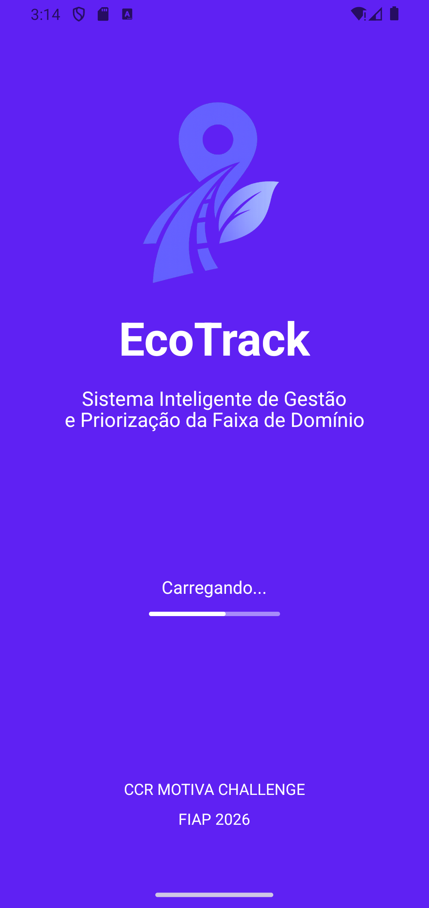
</p>

Tela de abertura responsável por apresentar a identidade visual do EcoTrack durante a inicialização da aplicação.

Funcionalidades:

- Identidade visual do projeto
- Indicador animado de carregamento
- Transição automática para a autenticação

---

## 01. Login

<p align="center">
  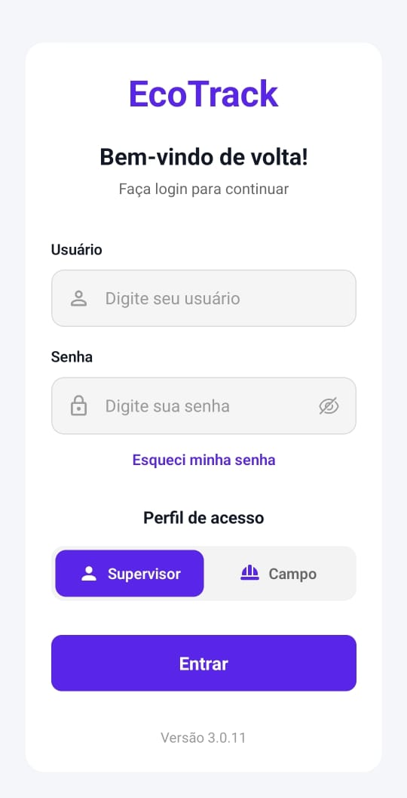
  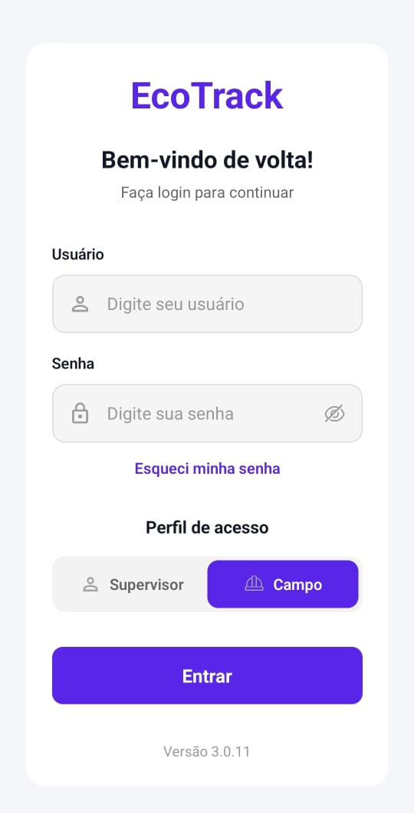
</p>

Funcionalidades:

- Validação de e-mail
- Validação de senha
- Exibição e ocultação da senha
- Seleção do perfil Supervisor ou Campo
- Validação das credenciais de acordo com o perfil
- Navegação para o sistema

---

## 02. Dashboard Inicial

<p align="center">
  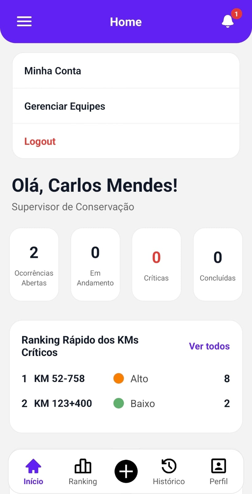
  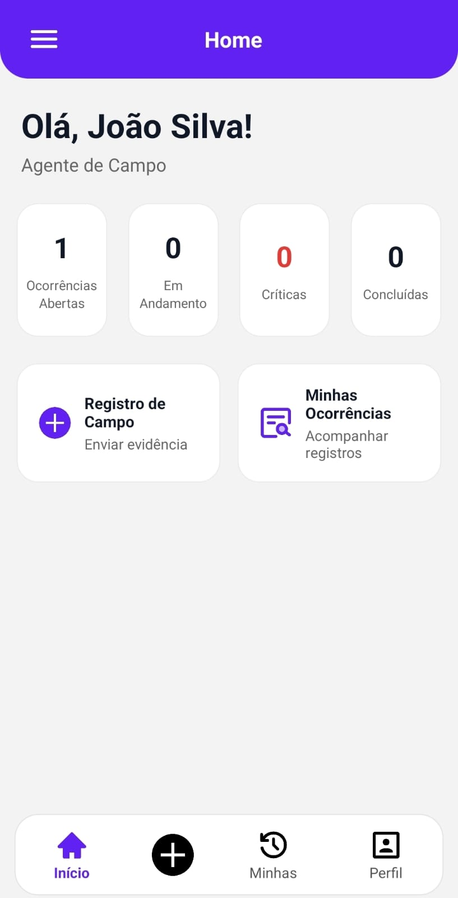
</p>

Funcionalidades:

- Indicadores operacionais
- Quantidade de ocorrências por status
- Indicador de ocorrências críticas
- Cards navegáveis
- Aplicação automática de filtros no Histórico
- Ranking resumido para o Supervisor
- Acesso rápido ao registro e histórico
- Central de notificações para o Supervisor
- Experiência adaptada ao perfil de acesso
- Menu de acesso à conta e logout

---

## 03. Histórico de Ocorrências

<p align="center">
  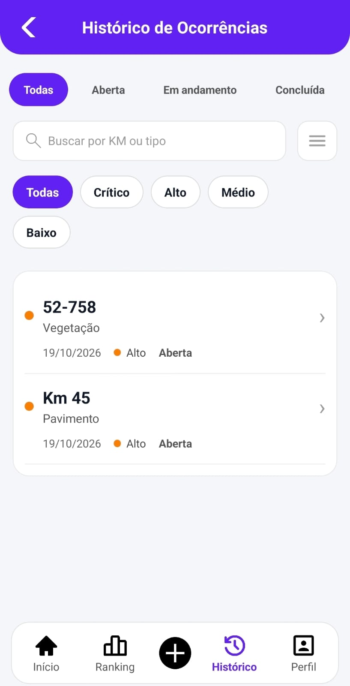
</p>

Funcionalidades:

- Consulta dos registros cadastrados
- Busca por KM
- Busca por tipo
- Filtro por status
- Filtro por criticidade
- Recebimento automático de filtros da Home
- Acesso aos detalhes da ocorrência
- Exibição adequada ao perfil de acesso

---

## 04. Confirmação de Envio

<p align="center">
  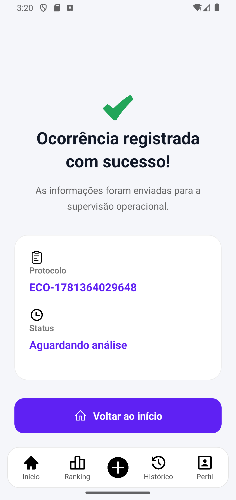
</p>

Funcionalidades:

- Confirmação visual do registro
- Geração automática do protocolo
- Exibição do status inicial da ocorrência
- Retorno ao dashboard

---

## 05. Registro de Ocorrência

<p align="center">
  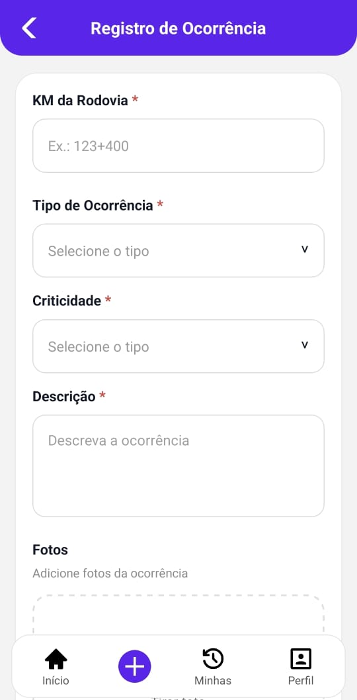
  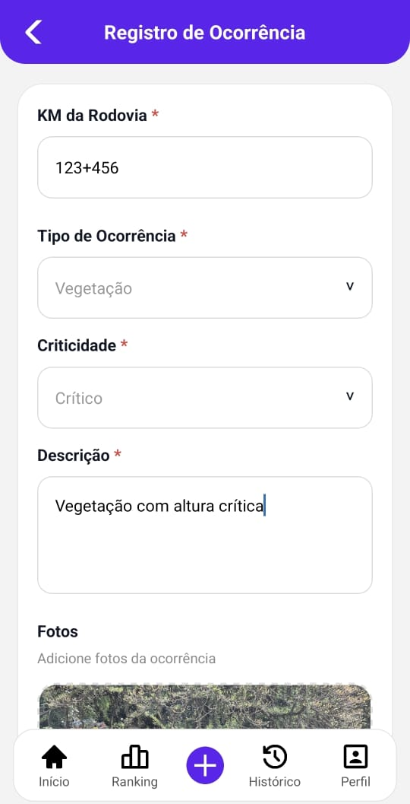
  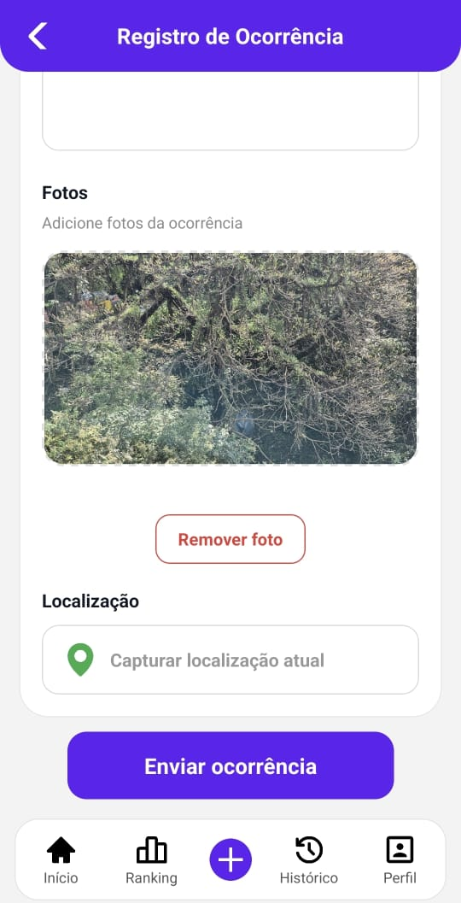
</p>

<p align="center">
  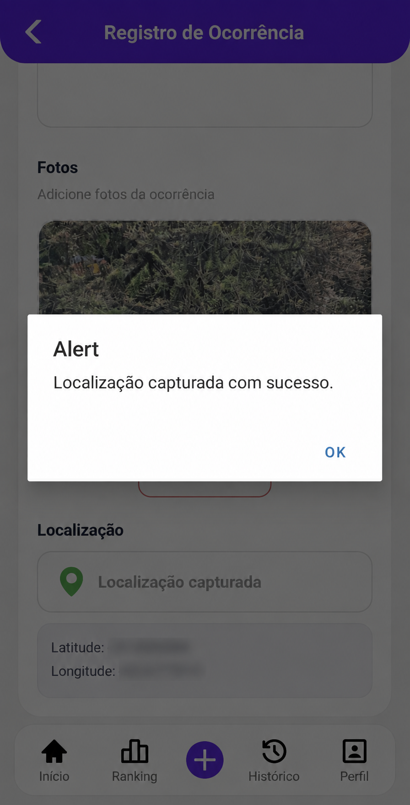
</p>

Funcionalidades:

- Cadastro de ocorrências
- Preenchimento do KM da rodovia
- Suporte ao padrão de KM, como `123+400`
- Seleção do tipo de ocorrência
- Definição de criticidade
- Descrição da ocorrência
- Registro fotográfico
- Remoção da evidência fotográfica
- Captura da localização atual
- Validação dos campos obrigatórios
- Envio da ocorrência

---

## 06. Detalhes da Ocorrência

<p align="center">
  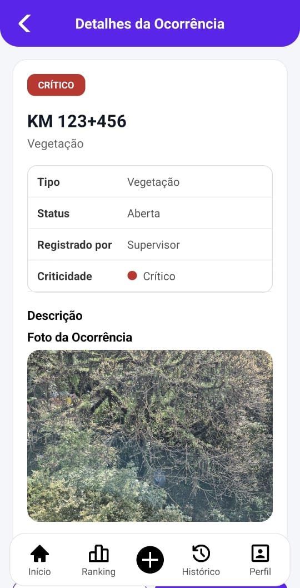
  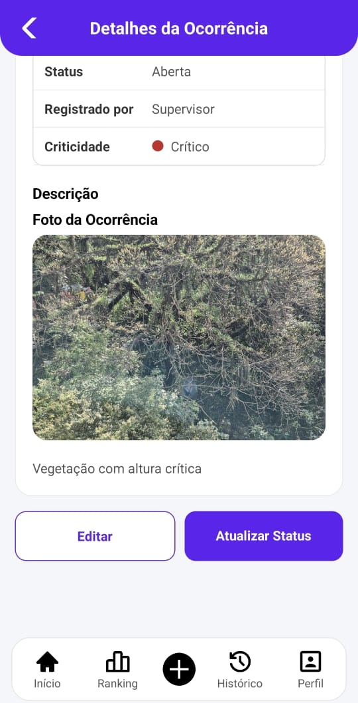
</p>

Funcionalidades:

- Consulta completa da ocorrência
- Visualização do KM
- Visualização do tipo
- Visualização da criticidade
- Visualização do status
- Identificação do perfil responsável pelo registro
- Visualização da descrição
- Visualização da evidência fotográfica
- Edição das informações
- Atualização do status

---

## 07. Ranking de KMs Críticos

<p align="center">
  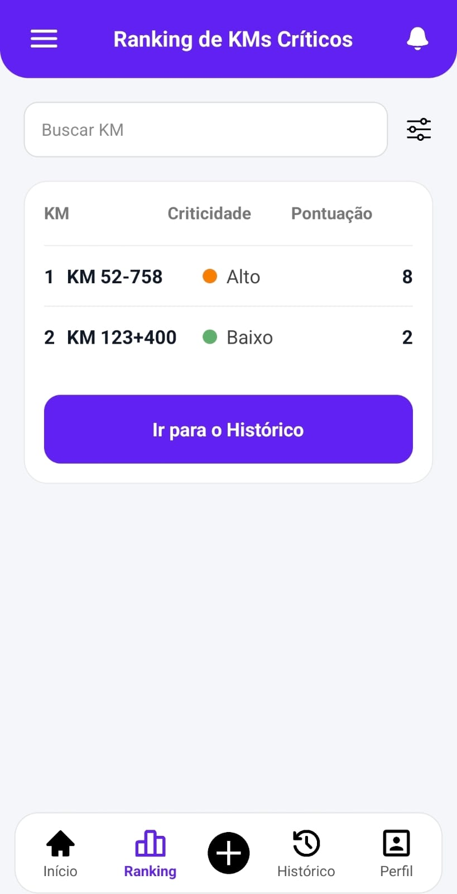
</p>

Funcionalidades:

- Visualização dos trechos priorizados
- Busca por KM
- Filtro por criticidade
- Classificação por pontuação
- Priorização das ocorrências
- Acesso rápido ao Histórico
- Recurso disponível ao perfil Supervisor

---

## 08. Minha Conta

### Supervisor

<p align="center">
  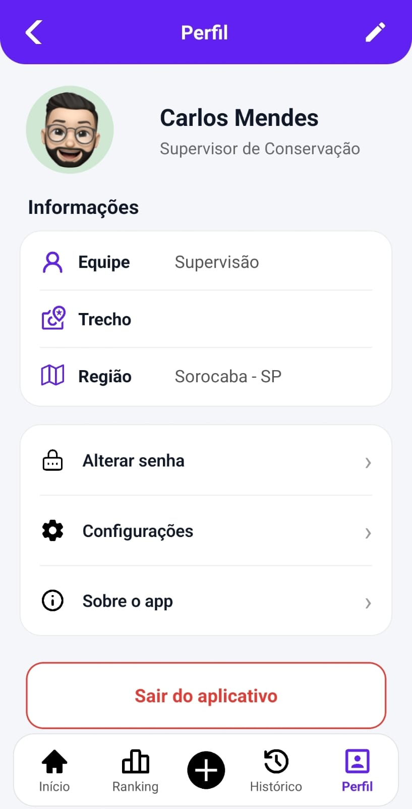
</p>

### Agente de Campo

<p align="center">
  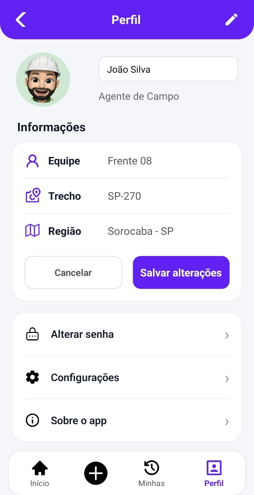
</p>

### Senha e Configurações

<p align="center">
  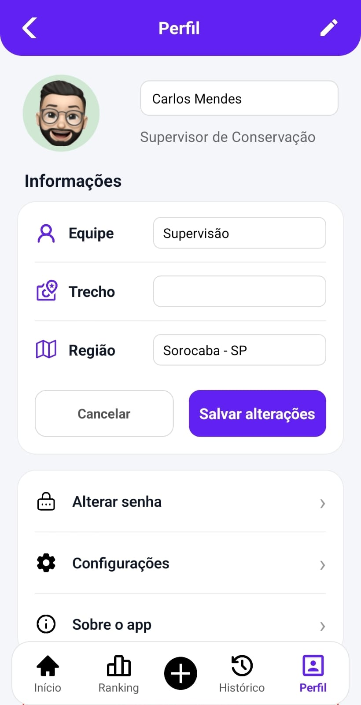
</p>

Funcionalidades:

- Visualização das informações do usuário
- Identificação do perfil de acesso
- Avatar adaptado ao perfil
- Edição das informações do perfil
- Alteração de senha
- Configuração das notificações
- Configuração da localização GPS
- Acesso às informações do aplicativo
- Logout

---

## 09. Sobre o App

<p align="center">
  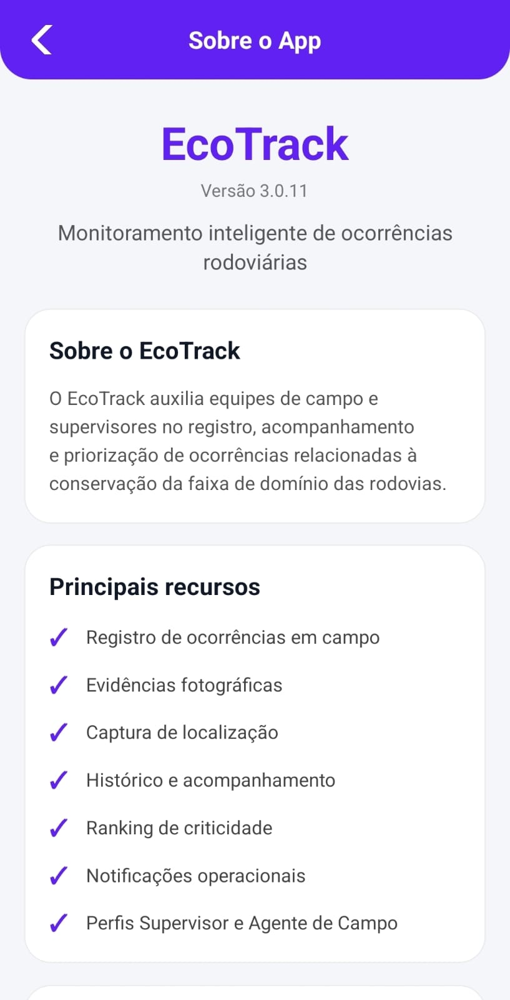
  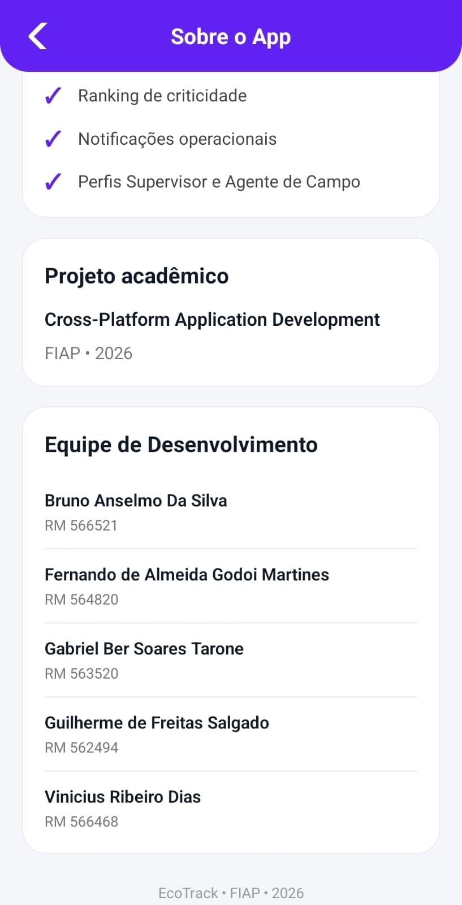
</p>

Tela dedicada às informações institucionais e acadêmicas do EcoTrack.

Funcionalidades:

- Apresentação do EcoTrack
- Identificação da versão
- Descrição dos principais recursos
- Informações acadêmicas
- Identificação da equipe de desenvolvimento
- Identificação dos integrantes e respectivos RMs

---

## 10. Notificações

<p align="center">
  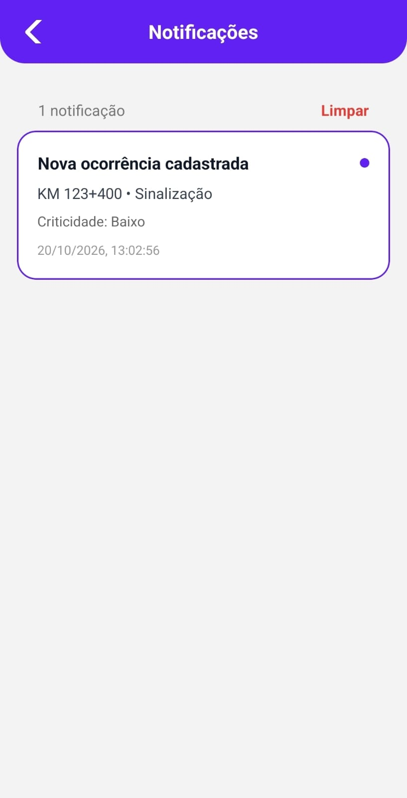
</p>

Funcionalidades:

- Centralização das notificações operacionais
- Identificação de novas ocorrências
- Exibição do KM e tipo da ocorrência
- Exibição da criticidade
- Identificação de notificações não lidas
- Acesso à ocorrência relacionada
- Opção para limpar as notificações

---

# 🧪 Dados e Cenários de Teste

Na Sprint 3, o EcoTrack utilizou dados simulados para demonstrar fluxos operacionais. Na Sprint 4, os fluxos de autenticação e gerenciamento de usuários foram integrados ao Firebase; a migração das ocorrências para o banco em nuvem ainda requer validação.

Os cenários contemplam diferentes:

- Status de ocorrência
- Níveis de criticidade
- Trechos rodoviários
- Perfis de acesso
- Registros operacionais
- Notificações

Essa estrutura permite validar os fluxos principais e alternativos da aplicação durante o desenvolvimento e a apresentação do protótipo.

---

# 💾 Persistência de Dados

O projeto utiliza **AsyncStorage** para preferências e dados locais do protótipo. O **Firebase Authentication** é utilizado na autenticação e o **Cloud Firestore** armazena perfis de usuários e informações de gerenciamento de agentes. A persistência de ocorrências no Firestore está em implantação.

### Persistência de imagens

Na versão do protótipo, as fotos das ocorrências são referenciadas localmente no dispositivo. O bucket do **Firebase Storage** foi configurado para a Sprint 4; o upload real pelo aplicativo precisa ser testado antes de ser considerado concluído.

---

# 🛠 Tecnologias Utilizadas

- React Native
- Expo
- JavaScript
- Context API
- AsyncStorage
- Expo Image Picker
- Expo Location
- Firebase Authentication
- Cloud Firestore
- Firebase Storage (configurado; integração do app em validação)

---

# 📂 Estrutura do Projeto

O projeto **EcoTrack está na raiz do repositório GitHub** `fiap-cpad-sprints`. O nome `ecotrack` pode ser usado para a pasta local no computador de um integrante, mas **não é uma subpasta do repositório clonado**.

```text
fiap-cpad-sprints/
├── assets/
│   ├── icons/
│   ├── images/
│   └── screenshots/
├── components/
│   └── BottomTab.js
├── context/
│   ├── ConfiguracoesContext.js
│   ├── NotificacoesContext.js
│   ├── OcorrenciasContext.js
│   └── UsuarioContext.js
├── screens/
│   ├── ConfirmacaoScreen.js
│   ├── DetalhesScreen.js
│   ├── GerenciarUsuariosScreen.js
│   ├── HistoricoScreen.js
│   ├── HomeScreen.js
│   ├── NotificacoesScreen.js
│   ├── PerfilScreen.js
│   ├── RankingScreen.js
│   ├── RegistroScreen.js
│   ├── SobreScreen.js
│   └── SplashScreen.js
├── App.js
├── index.js
├── app.json
├── eas.json
├── firebaseConfig.js
├── firebase.json
├── firestore.rules
├── package.json
├── package-lock.json
└── README.md
```

> A listagem representa os principais arquivos e diretórios do aplicativo. Outros arquivos de configuração e suporte podem estar presentes.

---

# ▶️ Como Instalar e Executar o Projeto (Desenvolvimento)

## Pré-requisitos

- **Node.js** e **npm** instalados.
- **Git** instalado.
- Dispositivo Android com **Expo Go** ou emulador Android compatível.
- Conexão à internet para os serviços Firebase.
- Conta autorizada para acessar o aplicativo; as credenciais são fornecidas pela equipe de forma privada.

## 1. Clonar o repositório

Abra o terminal e execute:

```bash
git clone https://github.com/nandoalmeidam/fiap-cpad-sprints.git
```

## 2. Entrar na pasta clonada

```bash
cd fiap-cpad-sprints
```

**Não execute `cd ecotrack` nem `cd sprints-cpad-2026`.** Essas pastas não existem dentro do repositório clonado.

## 3. Instalar as dependências

```bash
npm install
```

## 4. Iniciar o Expo

```bash
npx expo start
```

## 5. Abrir o aplicativo

- **Android físico:** abra o Expo Go e leia o QR Code exibido pelo Expo, quando compatível com a versão do projeto.
- **Emulador Android:** inicie o emulador e pressione `a` no terminal do Expo.

> O acesso à câmera, à galeria e à localização depende das permissões concedidas e dos recursos do dispositivo. A compatibilidade com o Expo Go deve ser verificada na versão do SDK utilizada; se necessário, use uma build de desenvolvimento.

## Firebase e acesso

O EcoTrack utiliza **Firebase Authentication** e **Cloud Firestore** para autenticação e dados de usuários. O Firebase Storage está configurado para a integração das evidências fotográficas, cuja validação ponta a ponta está em andamento.

O arquivo `firebaseConfig.js` contém a configuração do projeto Firebase. Para acessar o ambiente real, `USAR_EMULADORES` deve estar como `false`. O uso do aplicativo requer uma conta autorizada no Firebase Authentication e um documento de perfil correspondente no Firestore. **Não publique senhas, contas administrativas ou credenciais privadas neste README.**

---

# 🧪 Testes da Sprint 3

Os principais fluxos da aplicação devem ser validados manualmente antes da entrega.

Entre os cenários de teste estão:

- Login como Supervisor
- Login como Agente de Campo
- Tentativa de login com dados inválidos
- Navegação pelos indicadores da Home
- Registro de nova ocorrência
- Validação de campos obrigatórios
- Registro de evidência fotográfica
- Remoção de evidência fotográfica
- Captura de localização
- Consulta do histórico
- Aplicação de filtros
- Consulta dos detalhes
- Atualização de ocorrência
- Consulta do ranking pelo Supervisor
- Acesso às notificações
- Alteração de senha
- Alteração das configurações
- Acesso à tela Sobre o App
- Logout

---

# 🏁 Sprint 4 — Entrega Final

## Situação da entrega

| Item | Situação |
|---|---|
| Autenticação com Firebase e gerenciamento de agentes | Implementado; validar fluxos finais |
| Configuração do Cloud Firestore e regras de acesso | Configurado; validar integração ponta a ponta |
| Bucket e regras do Firebase Storage | Configurado; testar upload real |
| Persistência de ocorrências no Firestore | Em integração |
| Correções decorrentes dos testes da Sprint 3 | Revisão final pendente |
| APK Android instalável | Pendente |
| Plano de negócio | Versão preliminar abaixo; validar com a equipe |
| Pitch e demonstração (até 5 minutos) | Pendente |
| README consolidado | Em atualização |

## 📦 APK Android

**Link de download:** [ADICIONAR LINK DO APK FINAL]

**Status:** ainda não publicado. O APK será gerado e testado em um dispositivo Android antes da divulgação.

### Como instalar (após disponibilização)

1. Abra o link acima em um dispositivo Android.
2. Baixe o arquivo `.apk` da versão final.
3. Autorize a instalação do arquivo pelo navegador ou gerenciador de arquivos, caso o Android solicite.
4. Instale e abra o EcoTrack.
5. Utilize credenciais de teste fornecidas pela equipe de forma privada. Não publique senhas no README.

> O APK será hospedado externamente (por exemplo, GitHub Releases ou Google Drive), sem inclusão do binário nos commits do repositório.

## 🎥 Vídeo final

**Pitch e demonstração (até 5 minutos):** [ADICIONAR LINK DO YOUTUBE NÃO LISTADO]

O vídeo deverá apresentar a equipe, o problema, o aplicativo instalado e funcionando, o modelo de negócio e o impacto esperado para a Motiva, com participação dos integrantes.

---

# 💼 Plano de Negócio — Proposta Preliminar

> As definições abaixo são uma proposta para discussão e aprovação do grupo; não representam contrato, preço oficial ou resultado comprovado na Motiva.

### Proposta de valor

Centralizar registros de conservação da faixa de domínio, evidências fotográficas e informações de localização em um aplicativo móvel, facilitando a triagem e o acompanhamento de ocorrências por equipes operacionais e supervisores.

### Público-alvo e personas

- **Agente de campo:** registra ocorrências e evidências durante inspeções e acompanha o andamento das solicitações.
- **Supervisor de conservação:** consulta indicadores, filtra ocorrências, identifica trechos prioritários e organiza o acompanhamento das equipes.
- **Cliente institucional:** concessionárias rodoviárias e empresas responsáveis pela conservação e operação de rodovias.

### Modelo de receita proposto

Licenciamento **B2B por concessionária ou unidade operacional**, com mensalidade por faixa de usuários ativos e possibilidade de serviços adicionais de implantação, treinamento e suporte. Os valores dependerão de um piloto e da definição de escopo.

### Custos operacionais a estimar

Hospedagem e uso de Firebase (autenticação, banco e armazenamento), manutenção do aplicativo, suporte, monitoramento, distribuição Android, capacitação de usuários e eventuais integrações com sistemas corporativos. **Os custos monetários ainda precisam ser estimados e aprovados pelo grupo.**

### Diferenciais

- Fluxos distintos para Agente de Campo e Supervisor.
- Registro fotográfico e geolocalização associados às ocorrências.
- Histórico pesquisável, filtros e ranking de criticidade.
- Experiência mobile voltada às rotinas de conservação rodoviária.

### Riscos e mitigação

- **Conectividade em campo:** avaliar estratégia offline e sincronização em evolução futura.
- **Custos variáveis de nuvem:** configurar alertas orçamentários e acompanhar consumo; alertas não bloqueiam gastos.
- **Proteção de dados e acessos:** regras de segurança, autenticação e revisão periódica de permissões.
- **Adoção operacional:** executar piloto, treinamento e coleta de feedback.

### Impacto esperado

Melhor rastreabilidade dos registros, padronização de evidências e apoio à priorização de intervenções. Esses benefícios são **esperados** e deverão ser medidos em um piloto, não sendo apresentados como resultados já comprovados.

---

# 📅 Resumo das Quatro Sprints

| Sprint | Evolução |
|---|---|
| **Sprint 1** | Estrutura inicial do aplicativo, identidade visual e primeiros fluxos do protótipo. |
| **Sprint 2** | Evolução de login, registro de ocorrências, histórico, detalhes, ranking, perfil e configurações. |
| **Sprint 3** | Consolidação da navegação, diferenciação por perfil, indicadores, notificações, filtros, evidências e testes do protótipo. |
| **Sprint 4** | Integração com Firebase, revisão final, preparação do APK, plano de negócio, README e vídeo de apresentação. **Entrega em andamento.** |

---

# 📄 Entrega Acadêmica

A entrega final da disciplina será **um arquivo `.txt`**, contendo:

- Nome completo e RM de cada integrante;
- Link do repositório GitHub final com este README;
- Link de download do APK Android;
- Link do vídeo final no YouTube, configurado como não listado.

**Repositório:** https://github.com/nandoalmeidam/fiap-cpad-sprints

---

# 🎓 FIAP

Projeto acadêmico desenvolvido para a disciplina **Cross-Platform Application Development**, como parte do **Challenge Motiva**.

**FIAP • 2026**